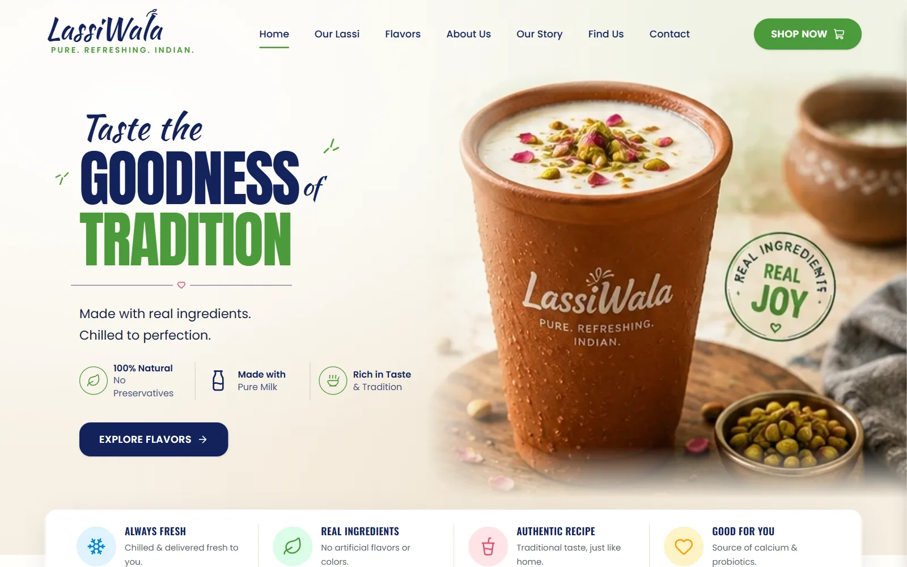
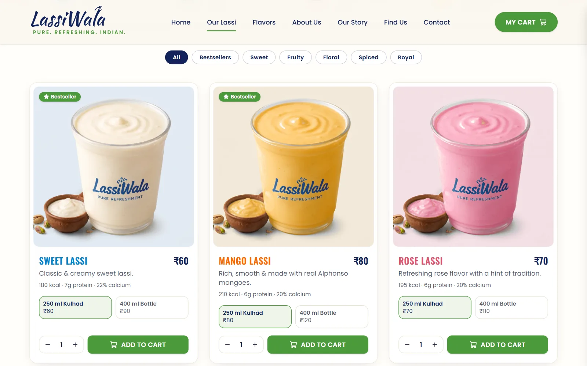
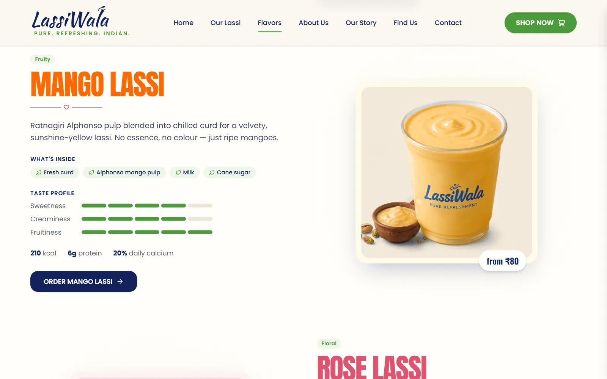
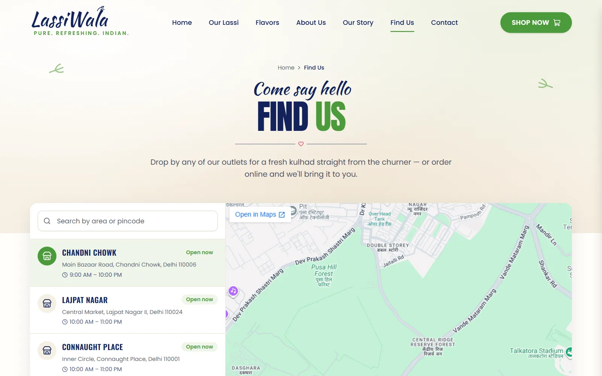

# LassiWala — Lassi & Beverage Brand Website Template

A cheerful multi-page website for a lassi bar, dairy or beverage brand, built with React 18, TypeScript, Vite, Tailwind CSS v4 and shadcn/ui. It includes a five-flavour range, an online shop with sizes, quantities and a slide-out cart, a page per flavour, an about page, a story timeline, an outlet finder with a map, and a contact page with FAQs.

**[Live demo](https://lassiwala.codespanda.com/)** · **[Template page](https://codespanda.com/templates/lassiwala)** · **[Documentation](https://codespanda.com/templates/lassiwala/docs)**



## Features

- **7 routed pages** — Home, Our Lassi (shop), Flavors, About Us, Our Story, Find Us and Contact, plus shipping, returns, terms and privacy pages and a 404 page.
- **Home** — a hero with a clay-kulhad photo, trust points, a highlights card, the lassi range, benefits, testimonials and a delivery banner with a pincode check.
- **Shop & cart** — filter by bestsellers or taste, choose a 250 ml kulhad or 400 ml bottle and a quantity, and add to a slide-out cart with totals and a free-delivery nudge. The cart is saved between visits.
- **Flavour pages** — ingredients, a taste profile, calories, protein and calcium for each of the five flavours, with a quick-jump bar.
- **About & story** — brand intro, stats, values, a how-it's-made process and a timeline.
- **Find us** — a searchable outlet list with live open-now status, an embedded Google Map, and call and directions buttons.
- **Contact** — call, WhatsApp, email and visit cards, a validated message form, opening hours and FAQs.
- **Fully responsive**, with shadcn/ui components and a navy, green and cream design.



## Tech stack

- React 18 and TypeScript
- [Vite](https://vitejs.dev) 6
- [Tailwind CSS v4](https://tailwindcss.com) and [shadcn/ui](https://ui.shadcn.com) (Radix UI)
- React Router 6
- [lucide-react](https://lucide.dev) icons; Anton, Oswald, Kaushan Script and Poppins from Google Fonts

## Getting started

You need Node.js 20 or newer.

```bash
npm install
npm run dev
```

Open [http://localhost:5173](http://localhost:5173).

| Command | What it does |
| --- | --- |
| `npm run dev` | Start the Vite dev server |
| `npm run build` | Type-check and build the production site into `dist/` |
| `npm run build:pages` | Build for GitHub Pages and copy `index.html` to `404.html` for deep links |
| `npm run preview` | Serve the built `dist/` folder locally |

## Project structure

```text
src/
  pages/            Home, OurLassi (shop), Flavors, About, OurStory, FindUs,
                    Contact, Policy (shipping, returns, terms, privacy), NotFound
  components/
    sections/       Header, Hero, Highlights, LassiRange, Feeling, Testimonials,
                    OrderBanner, Footer
    layout/         Layout, PageHero, CartSheet
    ui/             shadcn/ui primitives
    ornaments.tsx   Logo, heart divider, leaf sprigs and section titles
  context/cart.tsx  Cart state, saved to localStorage
  data/flavors.ts   Flavours, prices, sizes, ingredients and nutrition
  assets/           Product photos, hero and illustrations
  App.tsx           Routes
  index.css         Theme colors, fonts and Tailwind setup
design/             Original product photos the flavour images were made from
```

## Make it your own

- **Flavours and prices** — everything lives in `src/data/flavors.ts`: names, descriptions, photos, colours, taste profile, ingredients, nutrition and the price of each size. The home cards, shop, flavour pages and cart all read from it.
- **Photos** — replace the files in `src/assets/` (`sweet.webp`, `mango.webp`, `rose.webp`, `masala.webp`, `kesar.webp`, `hero.webp` and so on) and keep the same names.
- **Outlets** — edit the list in `src/pages/FindUs.tsx`. Each address also drives the map and the Directions button.
- **Contact details** — replace the phone, email and address in `src/pages/Contact.tsx` and `src/components/sections/Footer.tsx`.
- **Brand copy** — the stats, values, process and story timeline in `src/pages/About.tsx` and `src/pages/OurStory.tsx` are sample text.
- **Colors and fonts** — edit the CSS variables in `:root` in `src/index.css` (navy `--brand-navy: #13235b`, green `--brand-green: #4c9a3b`). Tailwind and the shadcn/ui components pick them up.
- **Orders and forms** — Place Order, the contact form and the pincode check show confirmations but don't send anything yet. Connect them to your ordering backend, payment gateway or form service.



## Deployment

`npm run build:pages` writes a static site to `dist/` with a `404.html` copy of `index.html`, so deep links like `/flavors` and `/policies/privacy` work on GitHub Pages.

**GitHub Pages** — `.github/workflows/deploy.yml` builds and deploys on every push to `main`.

1. In the repository, open **Settings → Pages** and set **Source** to **GitHub Actions**.
2. Push to `main`.
3. The site is served from a custom domain, so `vite.config.ts` uses `base: '/'`. To host it at `github.io/<repo>/` instead, build with `BASE_PATH=/<repo>/`.

**Netlify, Vercel or Cloudflare Pages** — use build command `npm run build` and output folder `dist`, with a rewrite of all routes to `/index.html`.



## Credits

Designed and built by [CodesPanda](https://codespanda.com). Browse more free templates at [codespanda.com/templates](https://codespanda.com/templates).
